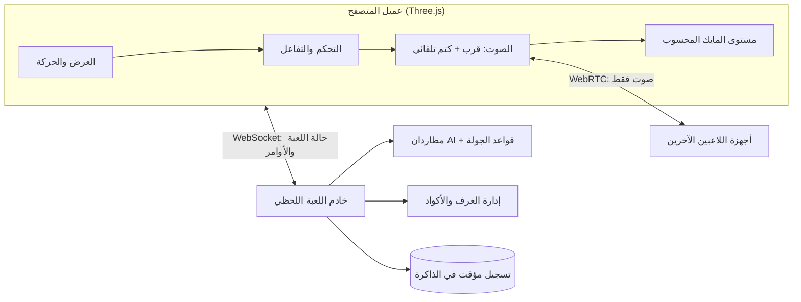

# Architecture v0.2 (مسودة) — Dark Signal

> هذه الوثيقة تُترجم `docs/USER_FLOW.md` v1.0 المعتمد إلى قرارات تقنية.
> لا تحتوي أي شيفرة، ولا تُنفذ قبل اعتمادها. أي رقم أو خدمة هنا **مقترح** حتى يُعلَّم بـ«معتمد».

## 1. نطاق هذه المرحلة

**داخل النطاق:** شكل النظام، توزيع السلطة بين العميل والخادم، بروتوكول الشبكة، بنية الصوت، تنفيذ معايرة المايك، سلوك AI المطاردين، حدود الأداء على الهاتف، خطة الإنجاز.

**خارج النطاق:** كتابة شيفرة اللعبة أو الخادم، تصميم الخريطة النهائي، الأصول ثلاثية الأبعاد، النشر الفعلي. هذه تُنفذ في مرحلة Backend وما بعدها.

## 2. قيود تصميمية حاكمة

| القيد | الأثر المعماري |
|---|---|
| ميزانية صفر | لا خدمة مدفوعة، ولا TURN تجاري، ولا قاعدة بيانات مُدارة مدفوعة. يُستخدم ما تسمح به الطبقات المجانية فقط، مع توثيق حدودها. |
| متصفح كمبيوتر + هاتف | WebGL عبر المتصفح، تصميم موبايل أولًا للأداء والتحكم باللمس. |
| 2–4 لاعبين في غرفة | جلسات صغيرة قصيرة العمر؛ لا حسابات دائمة، لا قاعدة بيانات طويلة الأجل. |
| مايك إلزامي + صوت قرب | صوت حقيقي بين المتصفحات (WebRTC) بجانب قناة لعب (WebSocket). |
| مطاردان AI | يُشغَّلان على الخادم لضمان عدالة ومنع الغش. |
| جولة ٣٠ دقيقة مستهدفة | لا مؤقت نهائي؛ الجولة تنتهي بأحداث لعب فقط. |

## 3. الشكل العام



- **الخادم اللحظي:** عملية Node.js واحدة تحمل الغرف في الذاكرة. تُفقد الغرف عند إعادة التشغيل، وهذا مقبول لجولات قصيرة.
- **الاستضافة المختارة (قرار المالك):** خدمة Render المجانية في المرحلة الأولى. حدودها موثقة هنا بصراحة: الخدمة تنام بعد خمول، والغرف في الذاكرة تُفقد عند إعادة التشغيل أو النوم. تُخفَّف المخاطرة بإبقاء الغرفة نشطة أثناء الجولة بمؤقّت حركة، وبرسالة عربية واضحة إذا انقطعت الجلسة، وبعدم الاعتماد على استمرار الخادم بين الجولات.
- **العميل:** Three.js (أو محرك مكافئ فوق WebGL) للعرض والحركة، وواجهة عربية.
- **الصوت:** WebRTC بين المتصفحات (mesh صغير)، والخادم يُبلّغ فقط من يجب أن يسمع من ومستوى الخفوت.

## 4. توزيع السلطة

المبدأ: **الخادم هو الحقيقة في كل ما يؤثر على الفوز والخسارة**، والعميل مسؤول عن الاستجابة الفورية والجماليات.

**قرار المالك (v0.2): تحقق كامل من التصادم على الخادم.** لذلك يرسل العميل **نيّة حركة** (اتجاه وسرعة وتدوير النظر) وليس موقعه النهائي. الخادم يشغّل الحركة والتصادم بمعدل 20 هرتز، ويبث المواقع؛ ويستخدم العميل **تنبؤًا محليًا** (client-side prediction) ثم **تصحيحًا** (reconciliation) عند اختلاف الحالة، مع تنعيم لمواقع الآخرين.

| النظام | السلطة | التفصيل |
|---|---|---|
| الحركة | الخادم بالكامل | العميل يرسل نيّة الحركة 20 هرتز؛ الخادم يحسب الحركة والتصادم ويبث النتيجة. التنبؤ على العميل للاستجابة فقط. |
| موقع المطاردين | الخادم | يبثّه للعملاء بمعدل أقل (10 هرتز) مع تنعيم على العميل. |
| الإمساك (catch) | الخادم | يُحتسب من المسافة وزاوية الرؤية على الخادم، لا من العميل. |
| القلوب/الإحياء/الفرصة الأخيرة | الخادم | حالة كل لاعب في الخادم فقط. |
| المسدس والتنويم | الخادم | يتحقق من الذخيرة، ويطبّق نوم ١٠ ثوانٍ. |
| كود الهروب | الخادم | يُولَّد لكل جولة، ويُقارن على الخادم؛ العميل لا يعرف الكود كاملًا. |
| الأدلة الأربعة | الخادم | يحفظ من جمع أي دليل، ويمنع إعادة الجمع. |
| الصديق المُنقَذ | الخادم | مسار اتباع مبدئي على الخادم؛ يُفقد نهائيًا عند الإمساك به. |
| الصوت | العميل + إشراف الخادم | الخفوت والقرب على العميل، والخادم يحدد من المسموح له التحدث في حالات المتفرج. |

منع الغش هنا **حدود عملية لا كمال**: العميل يرى ما حوله فقط (fog of interest) لتقليل المعلومات المتاحة للغشّاش، وقرارات اللعب الحاسمة تُحتسب على الخادم.

## 5. بروتوكول اللعب

- القناة: WebSocket واحد لكل لاعب، رسائل JSON مضغوطة (لاحقًا يمكن Binary).
- الترددات المقترحة: عميل→خادم 20 هرتز للحركة؛ خادم→عميل 10 هرتز لحالة المطاردين و15 هرتز لحالة اللاعبين الآخرين؛ أحداث فورية (إمساك، تنويم، إحياء، كود) تُرسل مباشرة.
- الفصل بين **حالة** (تُبث دوريًا) و**أحداث** (مرة واحدة، مع تأكيد من الخادم).
- إعادة الاتصال: نافذة قصيرة (٣٠ ثانية) يُحفظ فيها اللاعب بموقع مجمّد ثم يعود؛ عند انقطاع المايك وحده لا تُغلق الجلسة إطلاقًا، طبقًا لقرار «لا مهلة تلقائية».
- رسائل الخادم لا تحتوي كود الغرفة كاملًا في السجلات، ولا أسرار الجلسة الخاصة.

## 6. الصوت

### 6.1 المسار

1. كل لاعب يفتح قناة WebRTC مع كل لاعب آخر (mesh بحد أقصى ٦ قنوات في غرفة من ٤).
2. الخادم يرسل للعميل جدول القرب: من يسمع من، ووزن الخفوت التقريبي.
3. العميل يطبّق الوزن على مستوى كل قناة صوتية، ويمنع الإرسال كليًا عن من هم خارج المدى (٨ أمتار) لتوفير النطاق.

### 6.2 الحالات الخاصة المثبتة

| الحالة | الصوت |
|---|---|
| لعب عادي | مدى ٨ أمتار، خفوت بالمسافة، تخفيف بسيط خلف الجدران/الأبواب (لا قطع). |
| لاعب ساقط ينتظر الإحياء | يسمعه الزملاء القريبون، لكن مستواه **لا يدخل** حساب كشف المطارد. |
| مشاهد (خارج نهائي أو هارب أو فاقد فرصة) | يصل صوته عالميًا لكل الفريق بلا حد مدى. |
| مايك منقطع | اللاعب مجمّد في مكانه، لا يخرج، ويستعيد اللعب عند عودة الجهاز. |

### 6.3 المعايرة

- تُنفَّذ على العميل: قياس مستوى ضوضاء الخلفية ٥ ثوانٍ، والنتيجة ترفع العتبة الشخصية لكشف المطارد فقط.
- تُرسل **قيمة العتبة** للخادم، ولا يُرسل الصوت الخام إطلاقًا.
- عند تأثر القياس: يُطلب صمت الفريق ٥ ثوانٍ وتُعاد المعايرة مرة واحدة عبر رسالة خادم موحّدة.
- إن بقي القياس غير صالح: يُقبل آخر قياس مع تحذير واضح، ولا تُلغى الجولة.

### 6.4 البنية التحتية الصوتية

- **قرار المالك (v0.2): STUN فقط، بلا TURN في المرحلة الأولى.**
- STUN عام مجاني (مثل STUN من Google) للاكتشاف، والاتصال المباشر بين المتصفحات.
- الحد المعروف والموثق: بعض شبكات الهاتف (خصوصًا CGNAT وشبكات المؤسسات) لن تسمح بالاتصال المباشر، فيفشل الصوت أو يعمل جزئيًا. يُظهر العميل رسالة عربية واضحة عند فشل الاتصال، وتُوصي الواجهة بشبكة منزلية عند الحاجة. يُراجع القرار إذا ثبت أنه يمنع فريق المالك من اللعب فعليًا.

## 7. التشغيل والحالة على الخادم

```text
Room { code, hostId, phase, players[], hunters[], friend, code, clues[], events[] }
Player { id, name, heart[], state, pos, micThreshold, spectatorOf }
```

- الغرف في الذاكرة، تُحذف عند انتهاء الجولة أو خلوّها من لاعبين.
- لا قاعدة بيانات للنسخة الأولى؛ يُمكن لاحقًا تخزين نتائج مجهولة إن أراد المالك إحصاءات.
- حدود المجانية تُوثّق عند الاختيار النهائي للمضيف (عدد الاتصالات، حدود الوقت، نوم الخدمة). خدمة مجانية تنام بعد خمول غير مناسبة لكسر الغرف؛ تُفضل خدمة تشغيل دائم محدود.

## 8. AI المطاردين

- يعمل على الخادم بمعدل 10 هرتز، بحالة لكل مطارد: `patrol → investigate → chase → stunned`.
- **الولد:** مدى سمع أوسع؛ **البنت:** زاوية رؤية أوسع. الأرقام تُضبط في Tuning وتُوثّق في هذا الملف لاحقًا.
- الأصوات المكشوفة: صوت اللاعب إن تجاوز عتبته، وأصوات اللعبة (عبور، سقوط، كود خاطئ).
- توقّف ١٠ ثوانٍ عند إصابة المسدس، ثم يعود إلى `investigate` من موضع الضربة.
- المطاردون لا يعرفون مواقع اللاعبين غيبًا؛ يتنقلون بمنطق «آخر صوت/آخر رؤية» للحفاظ على الرعب والعدالة.

## 9. شكل الخريطة وبياناتها

- **قرار المالك (v0.2):** قصر مزيج — غرف وممرات تحيط بـ**فناء مركزي واحد** يفتح خط نظر طويلًا ويجعل المطاردة أخطر.
- الخريطة تُخزَّن كبيانات (مجسمات تصادم + نقاط تفاعل + أماكن أدلة + مسارات دورية للمطاردين)، لا ككود مبعثر.
- الخادم يحتاج فقط مجسمات التصادم ومواضع التفاعل، لا الهندسة البصرية؛ يقلّل ذلك حجم البيانات المرسلة.
- الفناء المركزي يجعل «الاختباء في زاوية» غير كافٍ، ويجعل الضوء وخط النظر مؤثرين فعليًا.

## 10. الأداء على الهاتف

- هدف ٣٠ إطارًا في الثانية على هاتف متوسط، مع مشاهد ليست ثقيلة.
- إضاءة مبدئية Lightmaps/إضاءة مخبوزة، وتقليل الأضواء الديناميكية إلى بضع نقاط.
- تقليل النماذج وعدد المواد، ودمج الشبكات (mesh batching)، ونصوص Arabic معرّبة من اليمين.
- تحميل الخريطة مرة واحدة مع شاشة تحميل عربية؛ الغرف لا تُعاد بناؤها بين الجولات.

## 11. الأمان والخصوصية

- لا حسابات، لا بيانات شخصية، أسماء عرض قصيرة فقط.
- لا تسجيل صوت خام، ولا تخزين إنتاجي؛ إشارة المعايرة مستوى ضوضاء فقط.
- جلسة المالك: تُتحقق من جهة الخادم، وقيمتها **لا تُكتب** في الوثائق ولا في مستودع Git. طريقة إدخالها تُحسم قبل Backend.
- تحديد المعدل على رسائل WebSocket، وحد أقصى للاسم وللرسائل، وتنقية أي نص يظهر للاعبين.

## 12. خطة الإنجاز (مقترحة)

| المرحلة | الناتج | معيار الإنجاز |
|---|---|---|
| A | هيكل مشروع + خادم غرف + WebSocket + ردهة | لاعبان يدخلان غرفة ويتبادلان الحركة. |
| B | خريطة أولية + تحكم كمبيوتر/لمس + كشاف | التنقل ممكن بلا مطاردين. |
| C | مطاردان + إمساك + قلوب + إحياء | جولة كاملة في غرفة واحدة. |
| D | صوت WebRTC + مدى/خفوت + معايرة | فريق يتحدث ويُخفّي خلف الجدار. |
| E | أدلة + كود + هروب + نتائج | جولة تُفتح وتُنهى بنجاح أو خسارة. |
| F | ضبط أداء الهاتف + تجربة لاعبين | جولة ٣٠ دقيقة مستقرة على هاتف متوسط. |

## 13. قرارات Architecture

**محسومة في v0.2:**

1. الاستضافة: Render المجاني، مع توثيق النوم وفقدان حالة الغرف.
2. الصوت: STUN مباشر بلا TURN، مع توثيق الشبكات غير المدعومة.
3. الحركة: تحقق كامل من التصادم على الخادم مع تنبؤ وتصحيح على العميل.
4. الخريطة: مزيج — غرف وممرات حول **فناء مركزي واحد**، ليجمع سهولة AI/التصادم مع اتساع القصر.

**ما زال مطلوبًا:**

1. **جلسة المالك:** كيف تُدخل وتُتحقق من دون كتابة السر في المستودع أو واجهة العميل العامة؟
2. **الأرقام التكتيكية:** زاوية رؤية البنت، مدى سمع الولد، منحنى خفوت الصوت، وسرعات الحركة — تُضبط أثناء اختبار المرحلة B/C وتُوثّق هنا.

## نقطة التوقف

هذه مسودة أولى تحتاج مراجعة المالك قبل أي تنفيذ. المرحلة التالية بعد الاعتماد هي **Backend**: هيكل المشروع، خادم الغرف، ثم النواة اللحظية.
