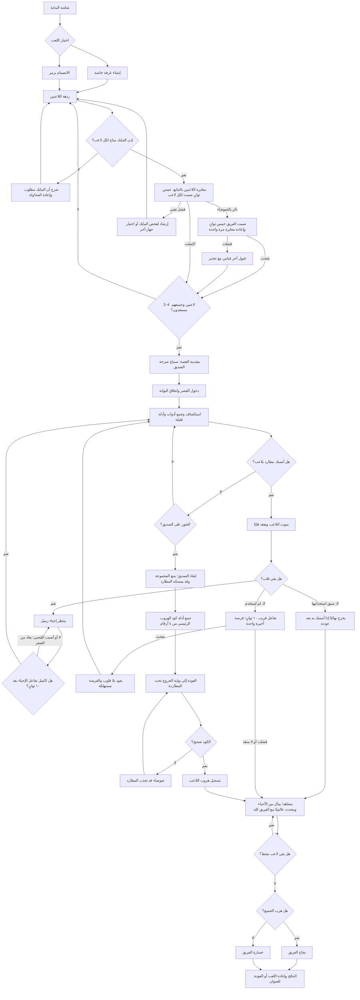

# User Flow v1.0 (معتمد) — Dark Signal

**الحالة:** مسودة تصميم للتعليق، وليست واجهات أو كودًا منفذًا.  
**المرحلة:** الثالثة بعد القصة ومراجع الفن. لا نبدأ architecture أو backend قبل مراجعة هذا التدفق.  
**قيد الميزانية:** صفر جنيه؛ لا حسابات أو مشتريات أو اشتراكات مدفوعة ضمن مسار اللاعب الأولي.

## 1. النطاق المؤكد المستخدم في هذا التدفق

- لعبة رعب تعاونية بمنظور أول، داخل متصفح الكمبيوتر والهاتف.
- من 2 إلى 4 لاعبين في الجولة.
- الهدف القصصي: العثور على الصديق وإنقاذه ثم الهرب من قصر مهجور بموقع غير محدد.
- مطاردان: ولد وبنت. **قرار المالك:** الولد يسمع أفضل، والبنت ترى أفضل.
- لكل لاعب مسدس لعبة غير قاتل؛ يوقف مطاردًا مؤقتًا ولا يقتله. **قرار المالك:** 10 ثوانٍ للتنويم وطلقة واحدة لكل لاعب، مع ذخيرة نادرة إضافية يمكن العثور عليها في القصر.
- **قرارات المالك:** إذا أمسك مطارد باللاعب، يموت ويفقد قلبًا، ثم ينتظر إحياءه من زميل؛ لكل لاعب ثلاثة قلوب. إذا نفدت، يخرج اللاعب مؤقتًا وللفريق فرصة إنقاذ أخيرة واحدة لكل لاعب. عند نجاحها يعود اللاعب بلا قلوب؛ إذا أمسك به المطارد بعدها يخرج نهائيًا. الفرصة الأخيرة تستخدم تفاعل الإحياء القريب نفسه، أي عشر ثوانٍ. إذا فشلت المحاولة أو لم يوجد منقذ، يبقى اللاعب مشاهدًا ويستطيع التبديل بين مشاهدة اللاعبين الأحياء. تستمر الجولة ما دام لاعب واحد نشطًا؛ إذا لم يبق أي لاعب نشط يخسر الفريق وتنتهي الجولة.
- **اقتراح مبسّط مفوّض للإحياء العادي والإنقاذ الأخير:** يمسك زميل زر التفاعل بجوار اللاعب لعشر ثوانٍ، من دون أداة أو لغز. لا يقطع المطارد التفاعل بالاقتراب، لكن إصابة المُحيي تلغيه وتعيده من الصفر.
- **قرار المالك:** نحو 30 دقيقة مدة مستهدفة للجولة، وليست عدادًا ينهيها تلقائيًا.
- أكواد قليلة؛ **قرار المالك:** كود هروب رئيسي واحد من ٤ أرقام يتغير بين الجولات، تكشفه ٤ أدلة موزعة في القصر.
- يوجد مسار خاص للمالك/المبرمج بكود هروب منفصل. قيمة الكود نفسها لا تُكتب في هذه الوثيقة أو في أي ملف عام.
- الأصوات داخل اللعبة، الضوء وخط النظر عناصر رعب. **قرارات المالك:** المايك الحقيقي إلزامي لكشف صوت اللاعب، وأصوات اللعبة تكشفه أيضًا. محادثة القرب (proximity voice) مداها ٨ أمتار في المساحة المفتوحة؛ خلف جدار أو باب مغلق يبقى الصوت مسموعًا مع تخفيف بسيط ولا ينقطع. لا يوجد زر كتم أثناء الجولة؛ إذا انقطع المايك يتوقف اللاعب في مكانه وينتظر استعادته بلا مهلة تلقائية، بينما يكمل الآخرون. أثناء انتظار الإحياء يسمع الزملاء اللاعب الساقط لكن صوته لا يجذب المطارد؛ وبعد خروجه النهائي يصل صوته عالميًا إلى الفريق كله. تُعاير ضوضاء الخلفية بالتتابع، خمس ثوانٍ لكل لاعب، ويصمت اللاعب الجاري قياسه وحده بينما تظل المحادثة مفتوحة. إذا أثرت أصوات الزملاء على القياس، يطلب النظام صمت الجميع خمس ثوانٍ ويعيد المعايرة مرة واحدة؛ إذا بقي القياس غير صالح بعد الإعادة، تُقبل المعايرة الأخيرة مع تحذير للاعب بدل منعه من الجولة.

## 2. مخطط المسار الرئيسي

## 3. المسار خطوة بخطوة

### 3.1 شاشة البداية

يعرض العنوان وخيارات واضحة بالعربية:

- **إنشاء غرفة خاصة**.
- **الانضمام برمز غرفة**.
- **الإعدادات والتحكم**.
- **المساعدة/طريقة اللعب**.

لا يوجد تسجيل حساب في النسخة الأولية المقترحة؛ يقلل خطوات الدخول والتكلفة. لا توجد مشتريات أو متجر.

### 3.2 إنشاء غرفة أو الانضمام

**إنشاء غرفة:** ينشئ اللاعب غرفة خاصة ويأخذ رمزًا يرسله لأصدقائه.  
**الانضمام:** يكتب اللاعب رمز الغرفة واسم عرض قصيرًا.

حالات الخطأ التي يجب أن تظهر برسائل عربية مفهومة:

- الرمز غير صحيح أو منتهي.
- الغرفة ممتلئة (الحد الأقصى 4).
- تعذر الاتصال؛ إعادة المحاولة أو الرجوع.
- الاسم غير صالح أو مستخدم في الغرفة.

لا يختار اللاعب المطارد ولا كود الجولة من الشاشة العامة.

### 3.3 ردهة الانتظار

- عرض أسماء اللاعبين وحالة الاستعداد.
- سعة الجولة من 2 إلى 4 لاعبين؛ نستخدم لاعبين كحد أدنى وفق نطاق المالك الحالي، ولا نفترض طورًا فرديًا.
- عرض تلميح تحكم مناسب للجهاز: لوحة مفاتيح/ماوس أو لمس.
- يبدأ المضيف الجولة بعد استعداد اللاعبين. سياسة مغادرة المضيف أو انقطاعه تُحسم لاحقًا في المعمارية.
- **المايك إلزامي حسب قرار المالك** لكشف صوت اللاعب وللمحادثة الصوتية بحسب القرب، إضافةً إلى أصوات اللعبة. يُطلب الإذن بوضوح في الردهة، ثم تُعاير ضوضاء الخلفية بالتتابع، خمس ثوانٍ لكل لاعب قبل وضعه على Ready؛ يظل صوت القرب مفتوحًا ويصمت اللاعب الجاري قياسه وحده. إذا أثرت أصوات الآخرين في القياس، يُطلب صمت الفريق كله خمس ثوانٍ وتُعاد المعايرة مرة واحدة. المعايرة تضبط كشف المطارد فقط ولا تغيّر مستوى المحادثة. إذا رُفض الإذن لمنح المايك أو تعذر تشغيله أصلًا، لا يصبح اللاعب مستعدًا وتظهر له رسالة لإعادة المحاولة/فتح إعدادات المتصفح. أما إذا بقيت المعايرة غير صالحة بعد الإعادة الوحيدة، فيُقبل آخر قياس مع تحذير واضح، ولا تُمنع الجولة بسبب التلوث الصوتي.
- **قرار المالك:** مدى المحادثة في مساحة مفتوحة ٨ أمتار؛ يخفت الصوت مع المسافة، وتخففه الجدران/الأبواب تخفيفًا بسيطًا من دون قطعه. منحنى الخفوت الرقمي يُضبط في Architecture.
- **قرار المالك:** لا يوجد زر كتم أثناء الجولة. إذا انقطع المايك أو تعذر الوصول إليه، يتوقف اللاعب وحده في مكانه وتظهر له شاشة لإعادة الاتصال؛ يستمر باقي الفريق. لا توجد مهلة تلقائية لطرده؛ يعود اللاعب إلى اللعب عند استعادة المايك.
- **مقترح خصوصية يحتاج تثبيتًا:** لا نسجل الصوت الخام ولا نخزنه؛ تستخدم المعايرة مستوى الضوضاء فقط. نوضح للاعب أن المايك يستخدم للمحادثة القريبة ولتحديد الأصوات التي قد تجذب المطارد، ومتى يكون نشطًا.

### 3.4 مقدمة القصة والدخول

تبدأ المجموعة (2–4 لاعبين) قرب القصر، تسمع صرخة صديق تعرفه، وتدخل بحثًا عنه. تُغلق البوابة خلفهم. المقدمة قصيرة؛ لا تحبس اللاعب في مشهد طويل قبل اللعب.

يظهر هدف واحد واضح، مثل: **«اعثروا على صديقكم»**. بعدها يتعلم اللاعبون التفاعل والكشاف أثناء الحركة بدل صفحة شرح طويلة.

### 3.5 الاستكشاف والتخفي

يعرض HUD هدفًا حاليًا واحدًا في كل مرة، ويتيح التفاعل مع:

- مفاتيح وأدوات قليلة لفتح مسارات داخل القصر.
- ٤ أدلة تقود إلى كود الهروب الرئيسي؛ لا تتحول الغرف كلها إلى لوحات أرقام.
- مسدس لعبة لكل لاعب؛ طلقة واحدة توقف مطاردًا لمدة ١٠ ثوانٍ ولا تقتله. ذخيرة نادرة إضافية تُلتقط في القصر.
- مخابئ أو زوايا اختباء، إذا اعتمدها تصميم الخريطة.

المطاردان يشكلان الخطر خلال الحركة:

- صوت اللاعب عبر المايك إذا تجاوز العتبة المضبوطة تلقائيًا من معايرة الردهة، وأصوات اللعبة مثل سقوط الأشياء والأبواب، قد تجذب المطارد.
- محادثة القرب: مداها ٨ أمتار في المساحة المفتوحة، يخف الصوت مع المسافة، وخلف جدار أو باب مغلق يبقى مسموعًا بخشونة أقل. الضبط الرقمي النهائي للمنحنى يُترك للـArchitecture.
- الرؤية تتطلب خط نظر، والضوء قد يكشف موقع اللاعب.
- **قرار المالك:** الولد يسمع أفضل، والبنت ترى أفضل. الأرقام الدقيقة لمدى السمع وزاوية الرؤية تُضبط في Architecture/Tuning.
- عند الإمساك، يفقد اللاعب قلبًا ويدخل حالة انتظار الإحياء من زميل. **اقتراح مبسّط مفوّض:** يقف الزميل بجواره ويمسك زر التفاعل لعشر ثوانٍ، من دون أداة أو لغز. **قرارات المالك:** لا يقطع المطارد الإحياء بمجرد الاقتراب؛ إذا أصاب اللاعب الذي ينفذ الإحياء، يُلغى التقدم ويبدأ من الصفر. ينطبق ذلك على الإحياء العادي والفرصة الأخيرة.
- أثناء الانتظار للإحياء، يظل صوت اللاعب مسموعًا لزملائه القريبين عبر proximity voice، لكنه لا يُحتسب لجذب المطارد.

### 3.6 إنقاذ الصديق

عند العثور على الصديق، ينفذ اللاعب أو الفريق تفاعل إنقاذ واضحًا، ثم يتبع الصديق المجموعة في طريق الخروج **(قرار المالك)** بسرعة قريبة من سرعة اللاعبين. يستطيع المطارد الإمساك به أو إبعاده **(قرار المالك)**؛ إذا أمسك به مرة أخرى بعد إنقاذه، **يُفقد نهائيًا** ولا يمكن إنقاذه مجددًا، ويصبح إنقاذه إنجازًا اختياريًا في الجولة. تبقى النهاية قائمة على هروب اللاعبين أنفسهم.

### 3.7 الهروب

- يعود اللاعبون إلى البوابة بعد جمع الأدلة الأربعة التي تكشف الكود.
- يدخلون كود الهروب الرئيسي المتغير على لوحة الخروج.
- الكود الخاطئ يصدر ضوضاء قد تجذب المطارد، وتُقفل اللوحة قليلًا قبل المحاولة التالية.
- عند نجاح الخروج، تُسجل حالة اللاعب `escaped`، وتستمر الجولة لمن لم يهرب بعد.
- يتحول اللاعب الهارب إلى متفرج يستطيع التبديل بين اللاعبين النشطين، ويتحدث صوته إلى الفريق كله من دون حدّ proximity.
- تنتهي الجولة بنجاح إذا هرب الجميع، وبخسارة الفريق إذا لم يبق أي لاعب نشط قبل هروب الجميع.

### 3.8 النتائج

تعرض الشاشة نتيجة الجولة بالعربية: من هرب، هل أُنقذ الصديق، وسبب انتهاء الجولة. ثم يختار الفريق إعادة جولة أو العودة للردهة.

**قرارات المالك:** الإمساك يسبب موت اللاعب وخصم قلب من رصيده الثلاثي؛ ينتظر بعدها إحياء زميل. إذا نفدت القلوب، يخرج اللاعب مؤقتًا وللفريق فرصة إنقاذ أخيرة واحدة لكل لاعب؛ يعود بعدها بلا قلوب، وأي إمساك لاحق يخرجه نهائيًا. **اقتراح مبدئي سهل للإحياء العادي والإنقاذ الأخير:** يمسك الزميل زر التفاعل بجوار اللاعب لعشر ثوانٍ، بلا أداة أو لغز؛ يستخدم الإجراء نفسه في الحالتين. إذا أصاب المطارد المُحيي يُلغى التقدم ويبدأ من الصفر. إذا فشلت الفرصة الأخيرة أو لم يوجد منقذ، يبقى اللاعب مشاهدًا ويستطيع التبديل بين مشاهدة اللاعبين الأحياء، كما يستطيع التحدث إلى الفريق كله عالميًا من دون حدّ proximity. تستمر الجولة ما دام هناك لاعب نشط؛ إذا لم يبق لاعب نشط تنتهي الجولة بخسارة الفريق.

## 4. مسار المالك/المبرمج الخاص

هذا ليس مسارًا عاديًا للاعبين:

1. يدخل المالك جلسة خاصة موثقة.
2. يصل إلى لوحة الخروج الطبيعية.
3. يدخل كود المالك السري المنفصل عن كود الجولة.
4. إذا تحقق الخادم من الصلاحية، تُسجل حالة المالك وحده `escaped`؛ لا يتغير كود الجولة ولا تنتهي اللعبة للآخرين.

لا يظهر الكود أو مسار الدخول الخاص في الواجهة العامة، ولا يُخزن في كود العميل أو المستودع. طريقة توثيق جلسة المالك تُحسم في architecture؛ لا نضع قيمة سرية هنا.

## 5. التحكم المقترح حسب الجهاز

| الجهاز | الحركة والنظر | التفاعل | الكشاف/المسدس |
|---|---|---|---|
| الكمبيوتر | WASD + ماوس | E | أزرار واضحة مثل F للكشاف وزر مخصص للمسدس |
| الهاتف | عصا حركة افتراضية + سحب للنظر | زر تفاعل كبير | أزرار لمس منفصلة للكشاف والمسدس |

هذه خريطة تحكم أولية وليست قرارًا نهائيًا. يجب أن يعمل التفاعل من اللمس دون الاعتماد على hover أو لوحة مفاتيح.

## 6. حالات حافة يجب أن يغطيها التدفق

- لاعب يحاول بدء اللعب قبل اكتمال الحد الأدنى.
- انقطاع لاعب من الغرفة أو عودته.
- رفض إذن المايك أو تعذر تشغيله؛ لا يصبح اللاعب مستعدًا حتى يعيد الإذن بنجاح. أما معايرة ضوضاء متأثرة فتؤدي إلى إعادة واحدة، ثم قبول آخر قياس بتحذير.
- انقطاع المايك أو الاتصال الصوتي أثناء الجولة؛ يتوقف اللاعب وحده في مكانه وتظهر له شاشة إعادة الاتصال، بينما يكمل الآخرون. يستعيد اللاعب التحكم بعد عودة المايك.
- لمس سريع/متعدد على الهاتف أثناء حركة اللاعب.
- إدخال كود خاطئ أو إرسال الطلب مرتين.
- لاعب يهرب قبل بقية الفريق.
- موت لاعب وفقده قلبًا؛ عند نفاد القلوب توجد فرصة إنقاذ أخيرة واحدة، يعود بعدها بلا قلوب، وأي إمساك لاحق يخرجه نهائيًا. إذا فشلت الفرصة أو لم يوجد منقذ يبقى مشاهدًا ويبدّل بين اللاعبين الأحياء؛ تنتهي الجولة بخسارة الفريق عند عدم بقاء أي لاعب نشط.
- المضيف يغادر قبل أو أثناء الجولة.

يُسجل الخطأ بالعربية ويتيح مسارًا مفهومًا للتعافي؛ معالجة الشبكة والسلطة النهائية للخادم تأتي في مرحلة architecture/backend، لا هنا.

## 7. حالة القرارات قبل الاعتماد

اتُّفق على ما يلي: مدى المحادثة ٨ أمتار وتخفيف بسيط خلف الجدران؛ يُقبل آخر قياس مايك بعد فشل الإعادة الوحيدة مع تحذير؛ المسدس يحمل طلقة واحدة وذخيرة نادرة إضافية؛ كود الهروب من أربعة أرقام يسبقه ٤ أدلة، والخطأ يصدر ضوضاء ويقفل اللوحة قليلًا؛ الولد يسمع أفضل والبنت ترى أفضل؛ الصديق يتبع المجموعة ويمكن الإمساك به.

**اعتماد المالك:** اعتُمد هذا التدفق كأساس لمرحلة Architecture في 5 نوفمبر 2026، مع تثبيت أن الصديق يتبع بسرعة اللاعبين، وأن إمساكه مرة أخرى يعني فقدانه نهائيًا.

لا قرارات جوهرية متبقية في التدفق. الأرقام التكتيكية (زوايا رؤية، مدى سمع، منحنى خفوت الصوت) تُضبط في Architecture/Tuning وتوثّق هناك.

## نقطة التوقف المقصودة

هذه الوثيقة ترسم مسار اللاعب فقط؛ لا تحدد قاعدة البيانات أو بروتوكول الشبكة أو AI المطاردين، ولا تنفذ أي backend. اعتُمدت في 5 نوفمبر 2026، والخطوة التالية هي **architecture** في `docs/ARCHITECTURE.md`. لا نبدأ backend قبل توثيق واعتماد architecture.
